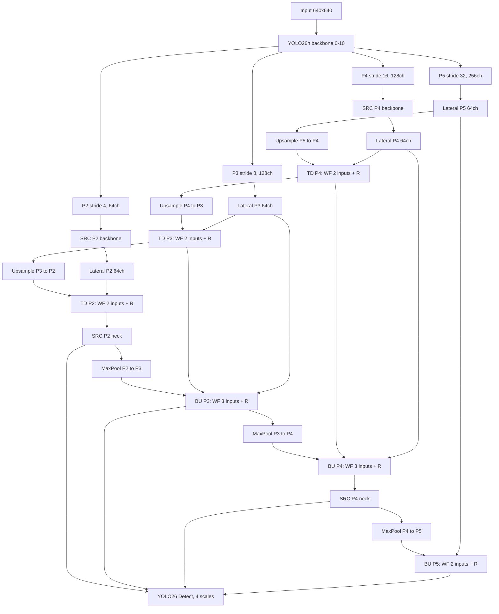

# Changelog

## 2026-11-09 - YOLO26n-P2 BiFPN + Spatial-Relational Co-Attention

### Phạm vi thay đổi

- Thêm YAML riêng `yolo26n-p2_bifpn_src.yaml` cho hai lớp `fire` và `smoke`. Model giữ các layer 0-10 của backbone YOLO26n, `end2end: True`, `reg_max: 1`, cùng `Detect` và hàm loss gốc của Ultralytics.
- Thêm `SpatialRelationalCoAttentionLite` tại `src/modules/bifpn_src/attention.py`; `WeightedBiFPNFusion` và `BiFPNRefine` tại `src/modules/bifpn_src/fusion.py`.
- Đăng ký ba module trong `src/modules/bifpn_src/__init__.py` để YAML parser nhận diện. Các điểm vào train, infer và evaluate import module trước khi nạp model.
- Thêm `src/modules/bifpn_src/validate.py` để kiểm tra đồ thị, stride, kích thước đặc trưng, loss gốc và gradient. `config.yaml` hiện trỏ tới model mới.

### Backbone và các mức phát hiện

Với scale `n`, backbone YOLO26n giữ các layer 0-10 để chuyển trọng số từ checkpoint P2. Hai module attention được đặt sau layer 2 của P2 (tạo layer 11, 64 kênh) và sau layer 6 của P4 (tạo layer 12, 128 kênh). Bốn phép tích chập lateral 1x1 đưa P2/P3/P4/P5 về cùng 64 kênh trước khi hợp nhất.

| Mức | Layer backbone | Stride | Kích thước với input 640x640 | Số kênh trước lateral |
| --- | ---: | ---: | ---: | ---: |
| P2 | 2 | 4 | 160x160 | 64 |
| P3 | 4 | 8 | 80x80 | 128 |
| P4 | 6 | 16 | 40x40 | 128 |
| P5 | 10 | 32 | 20x20 | 256 |

Attention tại P2 nhằm giữ chi tiết của vật thể nhỏ, còn P4 bổ sung ngữ cảnh. Đây là mục tiêu thiết kế; chưa có kết quả thực nghiệm chứng minh độ nhạy với đám cháy hoặc khói rất nhỏ được cải thiện.

### SpatialRelationalCoAttentionLite hoạt động như thế nào

Module giữ nguyên kích thước tensor `[B, C, H, W]` và có hai nhánh bổ trợ nhau:

1. **Spatial:** tính trung bình và giá trị lớn nhất theo chiều kênh của đầu vào, ghép thành hai bản đồ, rồi đưa qua phép tích chập 7x7 để tạo `spatial_logits` ở độ phân giải gốc.
2. **Relational:** dùng adaptive pooling đưa đặc trưng đầu vào và spatial gate xuống tối đa 8x8; spatial gate điều chế đặc trưng đã pooling. Một phép tích chập 1x1 chung tạo Q/K/V, sau đó scaled dot-product attention học quan hệ giữa tối đa 64 vị trí.
3. **Co-attention:** đầu ra relational tạo một bản đồ không gian một kênh và một channel gate gồm C kênh. Bản đồ không gian được nội suy về HxW rồi cộng với `spatial_logits`; hai gate điều chế đầu vào theo `x + tanh(gain) * (x * spatial_gate * channel_gate)`.

`gain` được khởi tạo bằng 0, nên **mỗi module attention** là phép đồng nhất ở thời điểm khởi tạo; điều này giúp giữ nguyên đặc trưng đi qua các layer backbone đã nạp trọng số. `channels`, `reduction` và `pool_size` là các tham số cấu hình. YAML hiện đặt bốn module: backbone P2/P4, neck P2 tại layer 32 và neck P4 tại layer 43. Việc pooling Q, K và V giới hạn ma trận attention tối đa 64x64 cho mỗi ảnh; chỉ bản đồ relational không gian một kênh được nội suy về độ phân giải gốc, tránh tạo thêm tensor relational CxHxW.

**Mức độ bám sát bài báo:** repository và yêu cầu không chỉ định một bài báo gốc cụ thể cho tên `Spatial-Relational Co-Attention`; tìm theo đúng tên này trên arXiv cũng không xác định được một bài báo tương ứng. Vì vậy, đây là module được thiết kế cho project, không phải bản tái hiện nguyên bản của một phương pháp SRC đã công bố. Spatial gate dựa trên trung bình và cực đại theo kênh có điểm tương đồng với [CBAM](https://arxiv.org/abs/1807.06521); scaled dot-product Q/K/V có điểm tương đồng với [Transformer](https://arxiv.org/abs/1706.03762) và [Non-local Neural Networks](https://arxiv.org/abs/1711.07971). Giới hạn 8x8, dùng spatial gate điều chế Q/K/V đã pooling, dùng relational gate theo không gian và kênh, cùng residual có hệ số khởi tạo bằng 0 là các lựa chọn thiết kế riêng. Module học quan hệ nội dung tổng quát; nó chưa mã hóa trực tiếp nhãn `fire`/`smoke` và không có auxiliary relation loss.

### BiFPN neck và hợp nhất có trọng số

Neck gồm **một cell** hai chiều với sáu nút hợp nhất; sau mỗi nút là `BiFPNRefine` gồm depthwise 3x3 -> pointwise 1x1 -> BatchNorm -> SiLU:

| Hướng | Nút | Đầu vào cùng mức / từ mức lân cận | Đầu ra |
| --- | --- | --- | --- |
| Top-down | P4 | lateral P4 + P5 nội suy lên | layer 21 |
| Top-down | P3 | lateral P3 + top-down P4 nội suy lên | layer 26 |
| Top-down | P2 | lateral P2 + top-down P3 nội suy lên | layer 31, sau attention là 32 |
| Bottom-up | P3 | lateral P3 + top-down P3 + P2 max-pool | layer 37 |
| Bottom-up | P4 | lateral P4 + top-down P4 + P3 max-pool | layer 42, sau attention là 43 |
| Bottom-up | P5 | lateral P5 + P4 max-pool | layer 48 |

Mỗi nút hợp nhất học các trọng số vô hướng riêng. Code dùng `positive_i = softplus(w_i)`, `alpha_i = positive_i / (sum_j positive_j + epsilon)` và `fused = sum_i alpha_i * feature_i`, với `epsilon = 1e-4`. Vì vậy, các trọng số không âm và được chuẩn hóa; tổng `alpha_i` nhỏ hơn 1 một lượng rất nhỏ do epsilon.

Ultralytics 8.4.140 không tự suy ra số kênh đầu ra của custom module dùng `from: [a,b,c]`. Vì vậy, đồ thị dùng `Concat -> WeightedBiFPNFusion -> Index [64,0] -> BiFPNRefine`: module fusion tách tensor đã nối thành các đặc trưng 64 kênh, tính tổng có trọng số và trả về tuple một phần tử; `Index` lấy tensor đó và khai báo 64 kênh cho parser. Cách này giữ nguyên parser gốc nhưng tạo tensor nối tạm thời 128/192 kênh, đặc biệt ở P2.

**Mức độ bám sát bài báo:** thiết kế tham khảo [EfficientDet, mục 3.2-3.3 và Hình 3](https://arxiv.org/html/1911.09070#S3). Nó giữ luồng hợp nhất top-down/bottom-up, trọng số học được và chuẩn hóa, các kết nối bổ sung ở cùng mức, cùng phép tinh chỉnh tích chập tách chiều sâu. Đây là **biến thể BiFPN cho YOLO26n**, không phải EfficientDet nguyên bản:

| Thành phần | EfficientDet gốc | Model này |
| --- | --- | --- |
| Backbone / head | EfficientNet + các head phân loại/hộp riêng | YOLO26n + `Detect` end-to-end gốc |
| Các mức phát hiện | P3-P7 | P2-P5, thêm P2 cho vật thể rất nhỏ |
| Số cell | Lặp nhiều BiFPN cell | Một cell top-down + bottom-up |
| Trọng số dương | ReLU(w) | Softplus(w), gradient trơn và luôn dương |
| Hợp nhất | Tính tổng có trọng số trực tiếp | Concat -> tổng có trọng số -> Index để parser xác định số kênh |
| Thay đổi kích thước | Resize theo đồ thị EfficientDet | Nearest upsample, MaxPool2d stride 2 |

### Head phát hiện P2 và kiểm tra tương thích

`Detect` nhận `[32, 37, 43, 48]` tương ứng P2/P3/P4/P5. Với input 640x640, bốn tensor đầu vào của head đều có 64 kênh và kích thước không gian lần lượt là 160x160, 80x80, 40x40 và 20x20; strides là `[4, 8, 16, 32]`. Head và end-to-end loss gốc xử lý đủ bốn mức; không thêm hàm loss phát hiện tùy chỉnh. P2 tăng số vị trí dự đoán cho vật thể nhỏ, đồng thời tăng chi phí tính toán so với YOLO26n ba mức.

Checkpoint `yolo26n-p2.pt` chuyển được 240 tensor từ các layer 0-10 của backbone; các module lateral, BiFPN, attention và `Detect` mới cần được huấn luyện. Với hai lớp và input 640x640, model có 1,619,542 tham số và khoảng 7.00 THOP GFLOPs. YOLO26n-P2 gốc có 2,516,240 tham số và khoảng 7.62 THOP GFLOPs; YOLO26n ba mức gốc có 2,504,580 tham số và khoảng 5.89 THOP GFLOPs. THOP có thể bỏ sót phép tính attention/fusion thực hiện qua hàm; đây không phải số đo latency thực tế.

### Sơ đồ kiến trúc

`TD` = top-down; `BU` = bottom-up; `WF` = hợp nhất có trọng số; `R` = BiFPNRefine; `SRC` = SpatialRelationalCoAttentionLite.



### Kiểm thử và giới hạn

Chạy `python src/modules/bifpn_src/validate.py` đã xác nhận model dựng được, cả bốn stride đúng, loss gốc chạy được lượt tính xuôi và lan truyền ngược; gradient hữu hạn, khác 0 ở cả sáu nút fusion và bốn hệ số gain của attention:

```text
Detect: 4 levels; strides [4, 8, 16, 32]
Features: [(1, 64, 64, 64), (1, 64, 32, 32), (1, 64, 16, 16), (1, 64, 8, 8)]
Stock loss: 7.7767; gradients: 6 fusions, 4 attentions
```

Chưa huấn luyện và đánh giá model mới trên DFire, Indoor Fire and Smoke hoặc DFS, nên chưa có bằng chứng rằng AP/recall của vật thể rất nhỏ được cải thiện hay tỷ lệ cảnh báo sai giảm. Cần đo trên GPU hoặc phần cứng đích để đánh giá độ trễ và mức dùng bộ nhớ thực tế.

---

## Các mốc trước đây

### 20h00 6/9/2026 - Hân Đồng
- Train và so sánh 3 model: `yolov8n`, `yolo11n`, `yolo26n` bằng dataset "DFire"
- Eval `yolo11n` và `yolo26n` bằng dataset "Indoor Fire and Smoke" và "DFS"
- Kết quả:

Baseline comparison:

| Model | Dataset | Precision | Recall | mAP50 | mAP50-95 | inference_ms | fps |
| --- | --- | --- | --- | --- | --- | --- | --- |
| yolov8n | DFire | 0.63705 | 0.55563 | 0.47418 | 0.24156 | 3.584 | 211.32 |
| yolo11n | DFire | 0.714 | 0.674 | 0.61 | 0.342 | 3.66 | 208.75 |
| yolo26n | DFire | **0.72933** | **0.67796** | **0.62782** | **0.36487** | 3.552 | 234.02 |

Domain adaptation test:

| Model | Dataset | Precision | Recall | mAP50 | mAP50-95 | inference_ms | fps |
| --- | --- | --- | --- | --- | --- | --- | --- |
| yolo11n | Indoor | 0.45202 | 0.29706 | 0.24102 | 0.11635 | 5.896 | 132.04 |
| yolo26n | Indoor | 0.50927 | 0.25554 | 0.2097 | 0.10709 | 5.301 | 150.39 |

Domain adaptation test:

| Model | Dataset | Precision | Recall | mAP50 | mAP50-95 | inference_ms | fps |
| --- | --- | --- | --- | --- | --- | --- | --- |
| yolo11n | DFS | 0.3784 | 0.31269 | 0.20877 | 0.08435 | 4.821 | 160.96 |
| yolo26n | DFS | 0.41136 | 0.31734 | 0.22778 | 0.09403 | 4.928 | 170.98 |


---

### 19h00 28/8/2026 - Hân Đồng

- Để các tất cả dataset vào `datasets/`, chia folder manifests/ và splits/ theo từng dataset.
- Chỉnh sửa audit, scanner, isolator, partitioner, manifest và verifier để có thể sử dụng cho các bất kì dataset. Sau khi chạy dataset pipeline, tự động tạo folder manifests/ và splits/ bên trong folder dataset tương ứng.

Ví dụ:
```
datasets/                   # Đã được thêm vào .gitignore
├──DFire/
│   ├── train/
│   ├── test/ 
│   ├── valid/ 
│   ├── manifest/           # Tự động tạo sau khi chạy dataset pipeline
│   └── splits/             # Tự động tạo sau khi chạy dataset pipeline
│
├──Indoor_Fire_and_Smoke/
│   ├── train/
│   ├── test/ 
│   ├── valid/ 
│   ├── manifest/           # Tự động tạo sau khi chạy dataset pipeline
│   └── splits/             # Tự động tạo sau khi chạy dataset pipeline
│
```
 
- Thêm `config.yaml` để cấu hình dùng chung cho dự án. Xóa các đường dẫn tuyệt đối để không phụ thuộc máy local.
- Cập nhật code CLI, train, evaluate và inference để phù hợp với những thay đổi ở `src/fire_audit/`.
